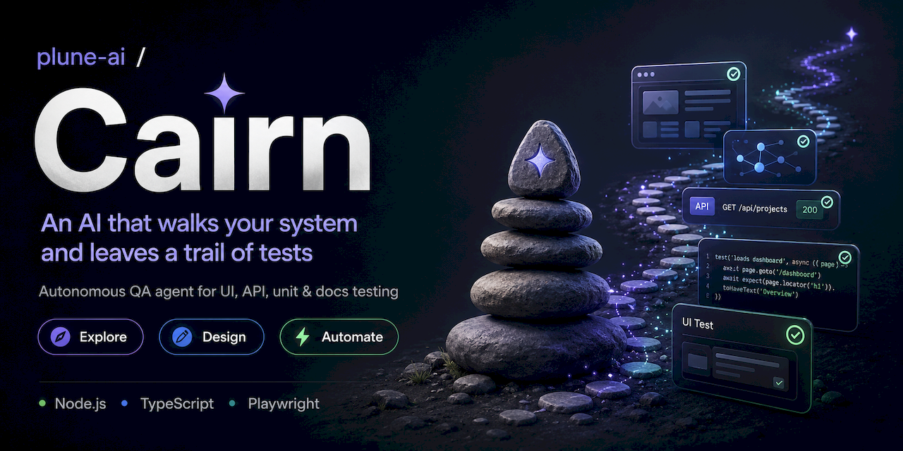

<p align="center">
  
</p>

# Cairn

> **Cairn — an AI that walks your system and leaves a trail of tests: UI, API, unit, docs.**

[](https://github.com/plune-ai/cairn/actions/workflows/ci.yml)
[](https://www.npmjs.com/package/@plune-ai/cairn)
[](package.json)
[](LICENSE)

▶ **Demo:** [`docs/demo/cairn.cast`](docs/demo/cairn.cast) — play with `asciinema play docs/demo/cairn.cast`

Autonomous QA agent (Node.js / TypeScript) that logs into a web app with a saved session, explores
pages (ARIA snapshot + screenshot), designs methodology-based UI test cases (ISO/IEC/IEEE 29119-4),
generates runnable `@playwright/test` code, self-validates, self-repairs, and **self-improves** via
Langfuse. A portable CLI + library for embedding into other TypeScript projects.

**Cairn is the generation layer** — it produces tests across surfaces (UI + API shipped; unit / docs
planned), each arriving by demand. A separate **Plune** layer owns record / management / eval.

> **Renamed Lex-Bot → Cairn.** The old `lex-bot` command and `@plune-ai/lex-bot` package still work
> (the CLI prints a one-line deprecation notice) — prefer `cairn` / `@plune-ai/cairn`. Legacy
> `LEX_`/`LEXBOT_` env vars still work too; prefer `CAIRN_`.

## What it does

Point it at a URL (behind login, with a saved Playwright `storageState`) and it will **observe** (ARIA
+ screenshot + interactive elements), **ground** (verify every locator, explore tabs/views, probe safe
state transitions — so it tests what is *actually* there, not hallucinations), **design** 29119-4 cases
(EP / BVA / decision-table / state-transition / error-guessing), **generate & validate** POM-style
`@playwright/test` specs with **self-repair** (keep-best: a repair never makes the suite worse), and
**judge & learn** (deterministic scorers + an LLM judge + a holistic **Pilot** verdict, traced to Langfuse).

It writes two kinds of case: **ATC** (*Automatable* — code is generated) and **MTC** (*Manual* — full
submits, security/XSS, visual/UX, irreversible actions — left for a human).

## Two decoupled modes

- **`design`** — explore + write cases as Markdown (`ATC-*` / `MTC-*`) with recorded selectors. **No code.**
- **`automate`** — generate `@playwright/test` code from approved `ATC-*` cases (skips `MTC-*`).
- **`explore`** — the full pipeline at once (cases → code → validation → repair → Pilot verdict).

Full walkthrough: **[Getting started](docs/getting-started.md)**.

## Install

```bash
npm install -g @plune-ai/cairn      # global CLI → run `cairn …`
# …or local / library:  npm install @plune-ai/cairn   → run via `npx cairn …`

cairn install-browsers              # one-time: the Chromium Cairn drives (its OWN Playwright revision)
```

Requires Node.js 20+. Copy `.env.example` → `.env` and add your keys. Browsers are a **separate
download** — run `cairn install-browsers` once, or pass `--channel chrome` to drive your installed
Chrome with **zero download** (also the simplest path for OAuth and for projects that already ship
Playwright). `cairn doctor` diagnoses the setup. See **[Authenticated targets](docs/sessions.md)** and
**[Configuration](docs/configuration.md)**.

## Quickstart

> Installed locally (without `-g`)? Prefix every `cairn …` below with `npx`.

```bash
# 1. Capture a login session once (a browser opens — log in, then press Enter)
cairn session capture --url https://app.example.com/login --name myapp

# 2. Design test cases (no code) — review the .md files it writes
cairn design --url https://app.example.com/page --session myapp --checklist plan.md

# 3. Automate the approved (ATC) cases → @playwright/test code, and run them
cairn automate --run runs/<id> --validate --session myapp

# …or do everything at once:
cairn explore --url https://app.example.com/page --session myapp --checklist plan.md
```

`--checklist` steers **what** the bot tests (and is scored as coverage) — copy
[`examples/plan.md`](examples/plan.md) as a starting point. Add `--fresh` to ignore prior runs of a URL,
`--style <pack>` to restyle cases ([Prompts & styles](docs/prompts-and-styles.md)), or `--critique` to
prune weak cases and top up technique gaps. (Git Bash: quote `--run 'runs/<id>'` or use the bare id.)

Add `--screencast` (to `explore`, or `automate --validate`) to record a **`.webm` per scenario** during
validation into `runs/<id>/screencasts/`, with a Playwright `trace.zip` beside each and a `screencasts.json`
sidecar mapping each scenario's step chapters (step → timecode). The timecodes come from the trace, counted
from the video's first frame (`"timing": "trace"`); when a trace cannot be read they are estimated from the step
durations (`"timing": "estimated"`). A run with a session, Basic Auth, environment secrets or a mailbox keeps no
trace, since Playwright would write them into it in the clear: its timecodes are estimated, and in the first
scenario of a worker they can run seconds late. It's a review-gate affordance — watch what the agent did before
approving a case. Off by default; the recorded `.webm` paths are linked from the run summary and the TUI result screen.

### Watch a run offline: `cairn view`

`cairn view <runDir>` (a path or a bare run id) builds **`view.html`** in a run that has screencasts and prints its
path. It is one self-contained file (inline CSS and JS) that plays the local `.webm` by a relative path and lists the
steps from `screencasts.json` with their times: click a step (or press Enter on it) to jump the video there; the
current step is marked while it plays. It works offline and nothing leaves your machine. A run with no steps shows
only the video and a note; a run with no video exits with an error naming the run directory. Add `--open` to open
the page in your default browser.

### API security: IDOR and privilege escalation across two actors

`cairn api --base-url https://staging.example.com --actors actors.json --allow-mutations` runs a check the
single-request `hacker` style cannot: it needs two identities and state. The owner (actor A) creates a resource
through a saved [API flow](docs/api-flows.md); the other actor (B) then tries to read it, change it and delete it, and
reads the ids next to it. Each 2xx answer to B is a finding with its OWASP WSTG id: `WSTG-ATHZ-04` (IDOR) when B is
another user, `WSTG-ATHZ-03` (privilege escalation) when B is a lower role. Only `401`, `403` and `404` count as
refused; any other answer (a redirect, `400`, `405`, `422`, a `5xx`) is inconclusive — a `PATCH {}` stopped by
validation never reached the access check — and fails the run like a finding. When every answer B got within a check
is a `401`, those cases are inconclusive too: B's credentials may not be valid, so access was not checked. A `401` next
to any other answer stays refused. A neighbouring id counts only when both actors can read it. The flow's own cleanup
deletes what was created, also when the check stops halfway; a check refused before its first request has no cleanup.
A cleanup step without `expect` is done only on a 2xx, and a cleanup that answers otherwise, or cannot be sent because
the create never returned its id, is reported as a cleanup error: the data may still be there. A captured JSON whole number past 2^53 stops the check, naming the capture: it may have been rounded, and a read or a cleanup must
not reach another record. A string id above 2^53 is used as written, and its neighbours are skipped.

```json
{
  "version": 1,
  "flows": "flows.json",
  "actors": {
    "owner": { "session": "alice" },
    "other": { "headers": { "Authorization": "Bearer {{env.BOB_TOKEN}}" }, "role": "peer" }
  },
  "checks": [
    { "flow": "project", "resource": "/api/projects/{{projectId}}", "change": { "method": "PATCH", "body": { "name": "x" } }, "neighbours": 2 }
  ]
}
```

An actor is a saved session by its name (`.auth/<name>.storageState.json`, from `cairn session capture --name`; set
`sessionsDir` to look elsewhere) or headers whose secrets are `{{env.NAME}}` only. The flow file's own `headers` (where
the owner's token usually sits) go to the owner whole. The other actor's requests carry no identity but its own actor
definition. From the flow file it takes only `Accept`, `Accept-Language`, `Content-Type` and `User-Agent`; its own
headers and session cookie come from `actors.json`. An error about a request says its method, its path and a category
(such as `network: ECONNREFUSED`), never the text of the underlying error. In the report and the terminal a captured
value is shown only as a whole number in the path, and not when it equals the value of an `{{env.NAME}}` that the flow
file or `actors.json` names; everything else stays as written, `{{name}}` and `{{env.NAME}}` alike, and so does the
whole query. The real values go only on the wire. What is known in advance is refused before the first request: a bad
header name, a header value whose characters cannot be sent because of an actor's header or an `{{env.NAME}}`, and,
anywhere in the flow's steps and cleanup, an `{{env.NAME}}` that is not set or that cannot stand in a path. A refused
header names itself and the templates it was built from. What a captured value holds is known only when it is sent: a
header with characters from one is refused then, naming the header. A URL that cannot be parsed is refused instead of
sent. So a secret from the environment never reaches the report or the terminal, with two known limits: a whole number
the server answered is shown unless it equals a value a file names, so a number that is a secret or part of one can be
shown when neither file names that exact value (`007` echoed as `7`); and a neighbour hidden because it equals a named
value, next to an id that is shown, tells what that value is. Header
names are merged case-insensitively (the actor's own win, a saved session's cookies win over a written
`Cookie`), so one name goes out with one value. The check uses the same guardrails as
every `cairn api` run: nothing is sent without `--allow-mutations`, so give it only a staging address you own, never
production; `--allowed-methods`, `--allowed-paths`, `--max-requests` and `--rps` hold as well, and a check whose flow or
cleanup they refuse is not started. Findings print with their WSTG id and go to `two-actor.json` in `--out`.

Exit codes, the first that applies wins: `1` for a two-actor file or saved session that cannot be used, a finding, an
inconclusive case, a check that stopped, a cleanup that failed, or a check `not tested` (it ran with no probe answered,
or `--allowed-methods`/`--allowed-paths` refused its flow or cleanup) while another check got an answer; `4` for a check
not started because the budget could not cover it; `5` when no probe in the run got an answer, because nothing was
tested (the owner's own requests do not count); otherwise `0`. A probe skipped next to answered ones stays a pass,
counted in the summary line.

More: [the runbook](docs/runbooks/run-api-cases.md#two-actor-check-idor-and-privilege-escalation---actors-233).

## Interactive TUI

Run `cairn` with **no arguments** in a terminal for a guided UI (launcher → form → live dashboard →
result summary → past-run browser). Ink/React are optional deps — see **[docs/tui.md](docs/tui.md)**.

## Commands

| Command | Purpose |
|---|---|
| `cairn session capture --url <loginUrl> --name <s>` | Capture a login session → `.auth/` (`cairn login` is a shorthand; `session ls` / `rm`) |
| `cairn observe --url <u> [--session <s>]` | ARIA snapshot + interactive elements + screenshot |
| `cairn design --url <u> --session <s> [--checklist <f>] [--style <s>] [--fresh] [--critique] [--flows <f>]` | Test cases only (ATC/MTC `.md` + selectors), no code; with `--flows`, data and sign-in preconditions use saved [API flows](docs/api-flows.md) |
| `cairn automate --run <dir> [--validate --session <s>] [--screencast] [--flows <f> [--allow-mutations]]` | `@playwright/test` from `ATC-*` cases; with `--flows`, specs get their data and sign-in from the flows' Playwright fixture |
| `cairn view <runDir> [--open]` | Build `view.html`: a run's screencast video with its steps as clickable chapters (offline) |
| `cairn promote --run <dir> --cases <ids> [--session <s>]` | Promote manual MTC case(s) to ATC (.md only; then `automate`) |
| `cairn explore --url <u> --session <s> [--checklist <f>] [--fresh] [--critique] [--screencast]` | Full pipeline (cases → code → validate → repair → Pilot) |
| `cairn api [--spec <path\|url>] [--base-url <u>] [--negative] [--scenarios] [--adversarial [styles]] [--min-coverage <percent> [--count-partial]] [--allow-mutations] [--allowed-methods <list>] [--allowed-paths <list>] [--max-requests <n>] [--rps <n>]` | Generate (and, with `--base-url`, run + assert status/contract) happy-path, negative-schema, multi-endpoint-scenario, and adversarial (`normal`/`curious`/`psycho`/`hacker`) cases from an OpenAPI 3.x spec. **With `--base-url` only GET/HEAD/OPTIONS are sent unless you pass `--allow-mutations`** (300 requests max, 5 req/s, host pinned, no redirects). Without `--spec`, the `--base-url` server is searched for a spec it serves (`/openapi.json`, `/v3/api-docs`, …). `--spec` also takes a Postman collection (v2.1) or a HAR file: it is converted to OpenAPI and saved as `openapi.derived.json` in the run directory |
| `cairn api --spec <s> --scenarios --save-flows <f>` · `cairn api --flows <f> [--out <dir>] [--base-url <u> --allow-mutations]` | Save scenario chains as [API flows](docs/api-flows.md) (create → return its id → delete), and write their Playwright fixture (`api-flows.fixture.ts`) for UI test setup and cleanup; sends no request. A flow that changes data runs only against an address allowed with `--allow-mutations` |
| `cairn api --base-url <u> --actors <f> --allow-mutations` | Two-actor API security check: IDOR (`WSTG-ATHZ-04`) and privilege escalation (`WSTG-ATHZ-03`) — the owner creates a resource through a saved API flow, the other actor tries to read, change and delete it and reads the ids next to it; the flow's cleanup always runs. See [below](#api-security-idor-and-privilege-escalation-across-two-actors) |
| `cairn experiment --dataset <d> --candidate name=file` | Compare prompt versions on a dataset |

> `lex-bot <command>` still runs every command above (deprecated alias — prints a notice, then runs `cairn`).

## Library API

```ts
import { runDesign, runAutomate, runExploration, loadConfig } from "@plune-ai/cairn";

const config = loadConfig(process.env);
const result = await runDesign({ url, config, sessionName: "myapp", checklistText });
// result.testCases, result.testCaseFiles, result.scores
```

## Documentation

- **[Getting started](docs/getting-started.md)** — step-by-step onboarding (session → design → review → promote → automate → validate).
- **[Authenticated targets](docs/sessions.md)** · **[Configuration & role routing](docs/configuration.md)** · **[Prompts & styles](docs/prompts-and-styles.md)** · **[Interactive TUI](docs/tui.md)** · **[MCP server](docs/mcp.md)**
- **[Metrics](docs/metrics.md)** · **[Cost benchmark](docs/cost.md)** · **[Langfuse](docs/langfuse.md)**
- **[Decision layer](docs/decider.md)** — an optional System One model (Jev in the cloud, Laya on your machine) for repair triage, checklist coverage and healing a broken locator; off by default, with a shadow mode to judge it first.
- **[Architecture overview](docs/architecture/overview.md)** — the plain async pipeline, locator grounding, self-improvement.
- **[Architecture Decision Records](docs/adr/README.md)** — why it's built this way (0001–0022, indexed).
- **[All documentation](docs/README.md)** — the full map of `docs/`.

## Development

```bash
npm run build        # tsc
npm test             # vitest (unit + integration; LLM/browser are mocked in unit)
npm run test:coverage
npm run lint
```

## License

Apache-2.0 (relicensed from GPL-3.0 in 0.3.0 — see [`docs/adr/0012`](docs/adr/0012-relicense-to-apache-2.0.md)). Methodology prompts ported from `AZANIR/qa-skills` (see [`docs/adr/0008`](docs/adr/0008-methodology-port-from-qa-skills.md)).
